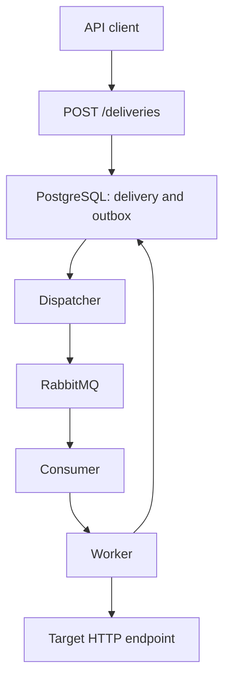

# Webhook Delivery Service

A portfolio backend project for reliable asynchronous webhook delivery using FastAPI, PostgreSQL, RabbitMQ, and Python.

The service accepts webhook delivery requests, stores them durably, publishes delivery messages through RabbitMQ, and sends the final HTTP requests through an asynchronous worker.

> **Status:** Work in progress. The successful delivery path works end to end, while some production-oriented capabilities are still planned.

## Architecture



The delivery flow is:

1. A client calls `POST /deliveries`.
2. Pydantic validates the JSON request.
3. A `WebhookDelivery` and an `OutboxMessage` are stored in the same PostgreSQL transaction.
4. The long-running dispatcher polls PostgreSQL for unpublished outbox messages.
5. The dispatcher publishes a persistent `webhook.delivery.requested` message to RabbitMQ.
6. The long-running consumer receives the message and loads the delivery from PostgreSQL.
7. The worker sends the webhook through HTTPX.
8. The delivery is updated as `succeeded`, `retry_scheduled`, or `failed`.
9. Successfully handled RabbitMQ messages are acknowledged.
10. The dispatcher and consumer remain active to process additional deliveries.

## Reliability Design

### Transactional Outbox

The delivery and its publication intent are stored atomically in PostgreSQL.

This avoids the dual-write problem where a delivery could be stored successfully but the application could stop before notifying RabbitMQ.

The dispatcher publishes rows whose `published_at` value is `NULL`. After a successful RabbitMQ publication, it records the publication timestamp.

The dispatcher reuses one publisher and creates a new database session for each polling cycle. It closes the session and waits one second after each completed batch, including empty batches.

### At-Least-Once Processing

A message may be delivered more than once if a process stops after performing work but before recording completion.

The worker therefore includes terminal-state guards to avoid processing deliveries already marked as `succeeded` or `failed`.

The consumer loads each delivery with `SELECT ... FOR UPDATE` before the worker
checks its state. Concurrent handlers for the same delivery wait for that row
lock. Once the first transaction commits, the next handler reads the updated
state and applies the existing worker guards.

The lock is held during the HTTP attempt until commit or rollback. Closing the
per-message session also ends any remaining transaction, including when a guard
returns without sending. This deliberately keeps a database transaction open
during HTTP I/O. Other delivery rows can be processed independently.

This coordinates concurrent handlers; delivery remains at least once. If a
receiver accepts the webhook but the worker stops before committing its result,
a later handler can send it again. Receivers can use `X-Delivery-ID` to deduplicate
the same delivery.

### Retry State

The sender classifies failures and includes a `retryable` flag in
`WebhookSendError`. The worker applies the following policy:

| Outcome | Delivery behavior |
| --- | --- |
| HTTP 2xx | Mark the delivery as `succeeded`. |
| HTTP 408, 429, or 5xx | Schedule a retry unless the attempt limit is reached. |
| Other HTTP status errors, including remaining 4xx and unfollowed 3xx | Mark the delivery as `failed` immediately. |
| HTTPX request errors, including network errors and timeouts | Schedule a retry unless the attempt limit is reached. |

A permanent failure still counts as an attempt and records `last_error`, but
leaves `next_attempt_at` unset. Once this outcome is committed, the consumer
acknowledges the RabbitMQ message. A handled HTTP failure does not requeue the
current message immediately.

Retryable failures are handled using:

- capped exponential backoff,
- jitter,
- a maximum number of attempts,
- `next_attempt_at`,
- `last_error`,
- terminal `failed` status.

Retries use the existing backoff and jitter policy. `Retry-After` response
headers are not currently used, and the consumer's HTTP client does not follow
redirects by default.

The retry scheduler selects deliveries whose status is `retry_scheduled` and whose
`next_attempt_at` is at or before the current UTC time. In one transaction, it
creates a new outbox message for each selected delivery, changes its status to
`pending`, and clears `next_attempt_at`. The delivery ID and attempt count are
preserved; the worker increments the attempt count when it performs the next send.

The worker leaves `retry_scheduled` deliveries unchanged, including when a
duplicate message arrives. Only the scheduler moves these deliveries to `pending`.

`FOR UPDATE SKIP LOCKED` prevents concurrent scheduler transactions from selecting
the same due delivery. The existing dispatcher and consumer process the new
outbox messages. Start the retry scheduler runner below to enable periodic checks.

### Rejected Messages and the Dead Letter Queue

Invalid message bodies and references to missing deliveries are rejected with
`requeue=False`. Configure dead-letter routing using the setup command below so
RabbitMQ sends these messages to a separate durable queue for investigation.

For the default delivery queue, setup creates:

| Resource | Name | Purpose |
| --- | --- | --- |
| Delivery queue | `webhook.deliveries` | Normal consumer input. |
| Direct exchange | `webhook.deliveries.dlx` | Routes rejected messages. |
| Dead letter queue | `webhook.deliveries.dlq` | Holds rejected messages for inspection. |
| Policy | `webhook.deliveries.dead-letter` | Applies dead-letter routing only to the delivery queue. |

Names are derived from `RABBITMQ_DELIVERY_QUEUE`. The policy uses an escaped,
anchored queue-name pattern and does not apply to the DLQ itself. The exchange
binding uses the original delivery queue name as its routing key.

HTTP delivery outcomes keep their existing handling: permanent failures become
`failed`, retryable failures can become `retry_scheduled`, and the message is
acknowledged after the outcome is committed. A database error still causes
`nack(requeue=True)`. These cases do not use the DLQ. There is no automatic replay
from the DLQ.

This uses the existing classic queues. Default RabbitMQ dead-letter forwarding
does not use internal publisher confirms and can lose a message if the target
queue is unavailable; durable queues do not remove that limitation.

## Technology Stack

- Python 3.14
- FastAPI
- Pydantic
- PostgreSQL
- SQLAlchemy ORM
- Psycopg
- Alembic
- RabbitMQ
- aio-pika
- HTTPX
- Docker Compose
- pytest

## API Endpoints

### Liveness

```http
GET /health/live
```

Checks whether the API process is running.

### Readiness

```http
GET /health/ready
```

Checks whether the API can connect to PostgreSQL.

### Create Delivery

```http
POST /deliveries
```

Example request:

```json
{
  "target_url": "https://example.com/webhooks",
  "event_type": "order.created",
  "payload": {
    "order_id": 123
  }
}
```

A newly created delivery starts with:

```json
{
  "status": "pending",
  "attempt_count": 0,
  "next_attempt_at": null,
  "last_error": null,
  "delivered_at": null
}
```

### Get Delivery

```http
GET /deliveries/{delivery_id}
```

Returns the current delivery state.

## Local Setup

### Requirements

- Python 3.14
- Docker Desktop
- Docker Compose
- Git

On Windows, Docker Desktop requires WSL 2 and hardware virtualization.

### Clone and Install

```powershell
git clone https://github.com/dionysisterziou/webhook-delivery-service.git
cd webhook-delivery-service

python -m venv .venv
.\.venv\Scripts\Activate.ps1

python -m pip install --editable ".[dev]"
```

### Environment Configuration

Create the local environment file:

```powershell
Copy-Item .env.example .env
```

When the Python processes run directly on Windows and PostgreSQL and RabbitMQ run through Docker, ensure the following values exist in `.env`:

```dotenv
POSTGRES_HOST=127.0.0.1
RABBITMQ_HOST=127.0.0.1
```

Using `127.0.0.1` also avoids slow IPv6-to-IPv4 fallback during local database connections.

### Start PostgreSQL and RabbitMQ

```powershell
docker compose up -d postgres rabbitmq
docker compose ps
```

Both services should report a healthy state.

The `-d` flag runs the containers in the background and returns the terminal prompt. This command selects PostgreSQL and RabbitMQ; the Python runners below run on the host in `.venv`. Running `docker compose up` without service names can also start the containerized API.

The RabbitMQ management interface is available at:

```text
http://localhost:15672
```

The application uses the `webhook_delivery` virtual host. Select it when inspecting queues through the management interface.

### Configure Dead-Letter Routing

After RabbitMQ is healthy, run this once before starting consumers:

```powershell
python -m webhook_delivery_service.rabbitmq_setup
```

Expected output with the default queue name:

```text
Dead-letter routing configured: webhook.deliveries -> webhook.deliveries.dlq
```

The command reads the existing `.env` settings and calls RabbitMQ's Management
HTTP API at `RABBITMQ_HOST:RABBITMQ_MANAGEMENT_PORT` (default port `15672`). The
Compose RabbitMQ image already includes the management plugin. The configured
RabbitMQ user must be allowed to declare resources and manage policies. No
PostgreSQL connection is made by this command.

Setup declares the durable destination queue/exchange and their binding, then
applies a policy to the existing delivery queue. It waits until RabbitMQ reports
the expected effective policy. It does not delete or purge queues. Re-running it
with the same configuration retains queued messages; conflicting declarations
raise an error instead of recreating queues.

The policy and durable resources persist in the RabbitMQ data volume. Repeat
setup after creating a fresh broker volume or changing the delivery queue name.
Normal publishers and consumers continue using AMQP and do not call the
Management API. Keep the existing credentials in `.env`; the new management
port setting has a default and is optional.

### Apply Database Migrations

```powershell
python -m alembic upgrade head
```

## Run the API

On Windows, start the API through the project runner:

```powershell
python -m webhook_delivery_service.api_runner
```

The runner starts Uvicorn using `SelectorEventLoop`, which is compatible with asynchronous Psycopg connections on Windows.

The API is available at:

```text
http://127.0.0.1:8000
```

Swagger UI is available at:

```text
http://127.0.0.1:8000/docs
```

Press `Ctrl+C` to stop the API cleanly. The runner prints:

```text
API stopped.
```

## Run the Retry Scheduler

After local setup, start the scheduler in a separate terminal from the repository
root with `.venv` activated:

```powershell
python -m webhook_delivery_service.retry_scheduler_runner
```

The scheduler processes up to 100 due retries per cycle. It creates a new database
session for each cycle, closes the session, and then waits one second, including
when no deliveries are due. It stays running without printing polling messages.

Keep the dispatcher and consumer running as well so newly scheduled retries can
reach the HTTP receiver. The scheduler records work in PostgreSQL; the dispatcher
publishes it to RabbitMQ.

Press `Ctrl+C` to stop the scheduler and dispose its database engine. Expected
output:

```text
Retry scheduler stopped.
```

## Manual End-to-End Delivery

The repository includes a small local HTTP receiver for verifying the complete delivery flow.

Complete the local setup, including database migrations, first. Run the following commands from the repository root in Windows PowerShell. Use a separate terminal for each of the receiver, API, consumer, and dispatcher, and keep all four processes running during the delivery checks. Use a fifth, free terminal for the HTTP requests and RabbitMQ queue checks.

### 1. Start the Local Receiver

In a separate terminal:

```powershell
.\.venv\Scripts\Activate.ps1
python -m uvicorn examples.webhook_receiver:app --host 127.0.0.1 --port 9000
```

The receiver listens at:

```text
http://127.0.0.1:9000/webhooks
```

It prints the received delivery ID, event type, and JSON payload.

### 2. Start the Delivery API

In another terminal:

```powershell
.\.venv\Scripts\Activate.ps1
python -m webhook_delivery_service.api_runner
```

### 3. Start the Long-Running Consumer

In another terminal:

```powershell
.\.venv\Scripts\Activate.ps1
python -m webhook_delivery_service.consumer_runner
```

The consumer remains active while the queue is empty and waits asynchronously for new messages.

### 4. Start the Long-Running Dispatcher

In another terminal:

```powershell
.\.venv\Scripts\Activate.ps1
python -m webhook_delivery_service.dispatcher_runner
```

The dispatcher remains active while the outbox is empty and automatically publishes newly created outbox messages. Keep it running for the following steps. Run only one dispatcher process at a time.

### 5. Create a Delivery

From a free PowerShell terminal:

```powershell
$body = @{
    target_url = "http://127.0.0.1:9000/webhooks"
    event_type = "order.created"
    payload = @{
        order_id = 123
        source = "manual-end-to-end-test"
    }
} | ConvertTo-Json -Depth 3

$delivery = Invoke-RestMethod `
    -Method Post `
    -Uri "http://127.0.0.1:8000/deliveries" `
    -ContentType "application/json" `
    -Body $body

$delivery
```

The response should contain:

```text
status        : pending
attempt_count : 0
```

The creation response represents the initial delivery state. Processing runs asynchronously, so the webhook may already have been delivered by the time you inspect this response. Use the GET request in step 7 to check the current persisted state.

### 6. Observe the Delivery

The already-running dispatcher publishes the new outbox message. The consumer receives the RabbitMQ message and sends the webhook through the worker.

The local receiver should display the real HTTP request, including:

- `X-Delivery-ID`,
- `X-Event-Type`,
- the original JSON payload.

After processing the message, both the dispatcher and consumer remain active.

To verify another delivery, repeat step 5 with a different payload and inspect its receiver output and final state. Keep the same dispatcher and consumer processes running throughout; no restart is required.

### 7. Verify the Final Delivery State

```powershell
Invoke-RestMethod `
    -Method Get `
    -Uri "http://127.0.0.1:8000/deliveries/$($delivery.id)"
```

Expected final values:

```text
status          : succeeded
attempt_count   : 1
next_attempt_at :
last_error      :
delivered_at    : <timestamp>
```

The RabbitMQ queue should show:

```text
Ready: 0
Unacked: 0
Total: 0
```

The same state can be checked from PowerShell:

```powershell
docker compose exec rabbitmq rabbitmqctl list_queues `
    -p webhook_delivery `
    name messages_ready messages_unacknowledged messages
```

Expected queue values:

```text
webhook.deliveries    0    0    0
```

### 8. Stop the Python Processes

After the delivery checks and once the queue is empty, press `Ctrl+C` in the dispatcher terminal and wait for it to exit.

Expected output:

```text
Dispatcher stopped.
```

The dispatcher cleanup closes the publisher connection and disposes the database engine.

Then press `Ctrl+C` in the consumer terminal.

Expected output:

```text
Consumer stopped.
```

The consumer cleanup closes its RabbitMQ connection and HTTP client and disposes its database engine. Stop the API and local receiver with `Ctrl+C` in their respective terminals.

To stop the Docker services without deleting their data:

```powershell
docker compose stop
```

## Manual Failure Classification Check

Complete local setup and migrations first. Keep PostgreSQL and RabbitMQ running,
along with one instance of each Python process: API, dispatcher, consumer, retry
scheduler and example receiver. Use a separate terminal for each process and a
sixth terminal for requests. The runner commands are documented above. Restart
the consumer and receiver after updating their source, and keep one receiver
process running throughout the check: its attempt counter is held in memory.

The receiver provides two controlled failures:

- `/webhooks/reject` always responds with HTTP 400.
- `/webhooks/fail-once` responds with HTTP 503 on the first request for each
  delivery ID, then HTTP 200 on subsequent requests for that same ID.

Create one delivery for each endpoint from the free PowerShell terminal:

```powershell
$rejectedBody = @{
    target_url = "http://127.0.0.1:9000/webhooks/reject"
    event_type = "integration.failure.permanent"
    payload = @{ source = "failure-classification-check" }
} | ConvertTo-Json -Depth 3

$rejectedDelivery = Invoke-RestMethod `
    -Method Post `
    -Uri "http://127.0.0.1:8000/deliveries" `
    -ContentType "application/json" `
    -Body $rejectedBody

$retryBody = @{
    target_url = "http://127.0.0.1:9000/webhooks/fail-once"
    event_type = "integration.failure.retryable"
    payload = @{ source = "failure-classification-check" }
} | ConvertTo-Json -Depth 3

$retryDelivery = Invoke-RestMethod `
    -Method Post `
    -Uri "http://127.0.0.1:8000/deliveries" `
    -ContentType "application/json" `
    -Body $retryBody
```

Read the two persisted states:

```powershell
foreach ($deliveryId in @($rejectedDelivery.id, $retryDelivery.id)) {
    Invoke-RestMethod `
        -Uri "http://127.0.0.1:8000/deliveries/$deliveryId" |
        Select-Object id, status, attempt_count, next_attempt_at, delivered_at, last_error |
        Format-List
}
```

Processing is asynchronous, so the first GET may still show `pending`. After
the first attempts, expect:

- The rejected delivery: `failed`, one attempt, a `last_error` containing HTTP
  400, and null `next_attempt_at` and `delivered_at`.
- The fail-once delivery: `retry_scheduled`, one attempt, and a future
  `next_attempt_at`. The first retry delay is 30-33 seconds, plus processing and
  polling time.

Repeat only the GET block after about 40 seconds. The rejected delivery must
remain `failed` with one attempt. The fail-once delivery should become
`succeeded` with two attempts, a non-null `delivered_at`, and cleared
`next_attempt_at` and `last_error`. If it has not finished, inspect the running
processes and repeat the GET within a 90-second observation window; a timeout
or an unexpected final state is not a passing result.

The receiver should show one HTTP 400 request for the rejected delivery, and
HTTP 503 followed by HTTP 200 for the fail-once delivery. Check RabbitMQ using
the queue command above: once processing finishes, the queue should contain
zero ready and unacknowledged messages if no other work is active. Stop all five
Python processes with `Ctrl+C` after the checks.

## Testing

Run the regular test suite:

```powershell
python -m pytest -q
```

Most tests run without Docker because external dependencies are replaced with mocks.

To check failure classification and its interaction with the consumer:

```powershell
python -m pytest tests/test_http_sender.py tests/test_worker.py tests/test_consumer.py tests/test_rabbitmq_consumer.py tests/test_delivery_failure_handling.py -q
```

The component checks run the real handler, worker and HTTP sender with mocked
HTTP transport, database session and RabbitMQ message acknowledgements. They
verify that recorded permanent and retryable HTTP failures are acknowledged
after commit. They do not replace the manual checks with real services above.

To run the dispatcher logic and runner tests together:

```powershell
python -m pytest tests/test_dispatcher.py tests/test_dispatcher_runner.py -q
```

These tests check mocked behavior. Use the manual delivery flow above to verify real database, RabbitMQ, and HTTP interactions.

The retry scheduler runner tests verify polling, session cleanup, interruption,
and event-loop selection without connecting to PostgreSQL:

```powershell
python -m pytest tests/test_retry_scheduler_runner.py -q
```

### PostgreSQL Integration Test

The real database integration test is opt-in.

Start PostgreSQL and enable it temporarily:

```powershell
docker compose up -d postgres

$env:RUN_DATABASE_INTEGRATION_TESTS = "1"
python -m pytest tests/integration/test_database_session.py -q
Remove-Item Env:RUN_DATABASE_INTEGRATION_TESTS
```

The test creates a real delivery and outbox message, reads them through a new database session, validates their stored state, and removes the test records afterward.

### Retry Scheduler Integration Tests

The scheduler integration tests use real PostgreSQL with tables created from the
models in a unique temporary schema for each scenario. This keeps the scheduler's
queries away from existing application deliveries. The temporary schema is
removed afterward. These tests cover due-time and status filtering, repeated
polls, batch limits, row locking, and rollback on an outbox insertion failure.

```powershell
docker compose start postgres
$env:RUN_DATABASE_INTEGRATION_TESTS = "1"
try {
    python -m pytest tests/integration/test_retry_scheduler.py -q
}
finally {
    Remove-Item Env:RUN_DATABASE_INTEGRATION_TESTS
}
```

### Consumer Concurrency Integration Test

This test uses real PostgreSQL with two independent sessions processing the same
delivery. A controlled sender pauses the first attempt while the second handler
starts. The test observes either a duplicate send or a PostgreSQL lock wait,
releases the first sender, and requires exactly one send and a persisted
`succeeded` delivery with one attempt. A unique temporary schema isolates its
data from application deliveries and is removed afterward.

It exercises the real consumer handler and worker, with a controlled sender;
RabbitMQ and an HTTP receiver are not required.

```powershell
docker compose start postgres
$env:RUN_DATABASE_INTEGRATION_TESTS = "1"
try {
    python -m pytest tests/integration/test_consumer_concurrency.py -q
}
finally {
    Remove-Item Env:RUN_DATABASE_INTEGRATION_TESTS
}
```

### RabbitMQ Dead-Letter Tests

The focused tests without a broker are:

```powershell
python -m pytest tests/test_rabbitmq_setup.py tests/test_rabbitmq.py tests/test_rabbitmq_consumer.py tests/test_delivery_failure_handling.py -q
```

The opt-in broker integration tests require RabbitMQ and its Management API.
They create uniquely named temporary queues, an exchange and a policy in the
configured virtual host, and delete only those test resources afterward.
Application queues and their messages are not consumed or cleared by these tests.

```powershell
docker compose start rabbitmq
$env:RUN_RABBITMQ_INTEGRATION_TESTS = "1"
try {
    python -m pytest tests/integration/test_rabbitmq_dead_lettering.py -q
}
finally {
    Remove-Item Env:RUN_RABBITMQ_INTEGRATION_TESTS
}
```

The six scenarios cover:

- Invalid JSON and a missing delivery: the original body and message ID reach
  the DLQ with an `x-death` header recording rejection from the source queue.
- Success: one send and an acknowledged message; repeating setup while the
  message is queued does not remove it.
- Permanent and retryable HTTP failures: the existing worker outcomes are
  recorded and acknowledged, without a dead letter.
- Database errors: the message is requeued and redelivered, without a dead letter.

The broker, publications and acknowledgements are real. The database session and
HTTP sender are mocked; these tests do not require PostgreSQL or the example
receiver and are not full HTTP end-to-end tests.

## Current Limitations

The RabbitMQ consumer is long-running. It waits continuously for new messages, reuses one HTTP client, creates a separate database session for each message, and supports clean shutdown with `Ctrl+C`.

Run a single dispatcher process. Concurrent dispatchers are not coordinated and may select the same unpublished outbox messages. Scheduled retries require the separate retry scheduler runner to be running.

The dispatcher and retry scheduler exit on unhandled errors. Restart them after
addressing the error; automatic process supervision is not configured.

The following capabilities are not implemented yet:

- automated RabbitMQ-to-HTTP end-to-end testing,
- webhook signing and authentication,
- metrics and production observability,
- production deployment configuration.

The service provides at-least-once-oriented processing. It does not claim exactly-once delivery.
